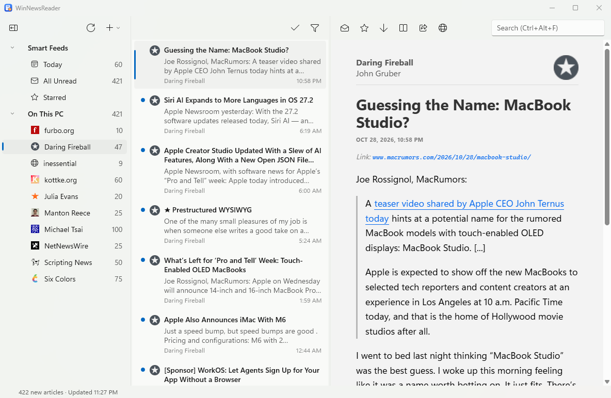

# WinNewsReader


A free feed reader for Windows, a native port of [NetNewsWire](https://github.com/Ranchero-Software/NetNewsWire) for the Mac. Website: [winnewsreader.com](https://winnewsreader.com).



**Status:** version 1.0.1. The installer is code-signed, but a new publisher has little SmartScreen reputation, so Windows may still warn when you install.

## Features

- Reads RSS, Atom, JSON Feed and RSS-in-JSON, with folders and OPML import and export
- Three-pane window with NetNewsWire's keyboard shortcuts, smart feeds, search, and a mail-style column layout
- NetNewsWire's article themes, Reader View, notifications, and dark mode
- Sync with Feedbin, NewsBlur, The Old Reader, BazQux and FreshRSS (Inoreader and Feedly are [not built yet](docs/FUTURE-SYNC-SERVICES.md))
- Your feeds stay on your PC; nothing is sent anywhere except to the sites and services you use

## Install

Get the latest installer from the [Releases](../../releases) page. It installs for the current user without administrator rights, sets up the WebView2 runtime if needed, registers `feed:` links and `.nnwtheme` files, and updates itself. See [docs/RELEASING.md](docs/RELEASING.md) for how releases are built.

## Build and run

Needs the .NET 10 SDK on Windows 10 1809 or later, and the WebView2 runtime (Windows 11 includes it).

```bash
dotnet test
dotnet run --project src/App
```

## Security review workflows

The Actions tab has two on-demand workflows from [multi-llm-security-review](https://github.com/shaztechio/multi-llm-security-review): **Security review** for provider selection, and **Security review (advanced)** for model overrides, OpenRouter tuning and SARIF controls. Both pin the workflow and tool to the same release 1.1.4 commit, which includes Gemini live log streaming and one continuation attempt if Gemini exits successfully without completing its report and SARIF. The continuation shares the original timeout budget; incomplete output still fails the review. With **Stream logs** enabled (the default), Claude, Codex, Gemini and OpenRouter show live progress in the job log. Gemini shows session start, tool names and paths, warnings and completion statistics; model text and file contents stay in the log artifact.

Add repository Actions secrets for the providers you select: `ANTHROPIC_API_KEY`, `OPENAI_API_KEY`, `GEMINI_API_KEY` and/or `OPENROUTER_API_KEY`. Enable **Settings → Actions → General → Allow GitHub Actions to create and approve pull requests**, then choose a workflow and **Run workflow**. Claude and Codex are selected by default; Gemini and OpenRouter are opt-in. Each selected provider opens its own draft PR with fixes and a findings report; SARIF findings go to code scanning. Reports, PRs and log artifacts are public in this repository. These workflows do not run automatically on pushes or pull requests.

## Documentation

- [docs/FEATURES.md](docs/FEATURES.md): using the app, accounts, shortcuts and the `wnr` command-line tool
- [docs/ARCHITECTURE.md](docs/ARCHITECTURE.md): what is in each project
- [docs/PLAN.md](docs/PLAN.md) and [docs/parity-matrix.md](docs/parity-matrix.md): the plan, and every NetNewsWire feature with its status
- [docs/MANUAL-TEST-CHECKLIST.md](docs/MANUAL-TEST-CHECKLIST.md): what still needs testing by hand
- [docs/FUTURE-SYNC-SERVICES.md](docs/FUTURE-SYNC-SERVICES.md): Inoreader and Feedly
- [AGENTS.md](AGENTS.md): an index of all the documents for people and tools working in the repository

## License

[MIT](LICENSE). Parts ported from NetNewsWire keep its own MIT license, noted in Credits below.

## Credits

- Parser code and test fixtures, and the article template, stylesheets, scripts and built-in themes in `src/Core/ArticleRendering/Resources`, are ported from NetNewsWire by Brent Simmons and contributors, under the MIT license ([src/Parser/LICENSE-NetNewsWire.txt](src/Parser/LICENSE-NetNewsWire.txt)).
- The NewsFax theme's ModeSeven font is freeware; see its `License.md`.
- Reader View uses [SmartReader](https://github.com/Strumenta/SmartReader), a C# port of Mozilla's Readability, under the Apache License 2.0.
- This project isn't affiliated with or endorsed by NetNewsWire.
